# 🏭 Control de Calidad en Manufactura: plataforma MLOps en Databricks


> 🎓 Proyecto académico basado en los materiales entregados por el profesor de la asignatura. Más detalles en [Equipo](#-equipo).

Sistema **end-to-end** para **predecir unidades defectuosas** en una línea de fabricación electrónica a partir de las lecturas de sensores de cada inspección. El proyecto cubre todo el ciclo de vida de un modelo en producción: ingesta en streaming, calidad de datos declarativa, arquitectura Medallion, Feature Store con *point-in-time joins*, experimentación con MLflow, registro gobernado en Unity Catalog, promoción **champion / challenger**, *baseline* de monitorización y un ciclo de **reentrenamiento** reproducible.

---

## 📑 Índice

1. [Problema de negocio](#-problema-de-negocio)
2. [Aspectos destacados](#-aspectos-destacados)
3. [Resultados en Databricks](#-resultados-en-databricks)
4. [Stack tecnológico](#-stack-tecnológico)
5. [Arquitectura general](#-arquitectura-general)
6. [Estructura del repositorio](#-estructura-del-repositorio)
7. [Ingeniería de datos: arquitectura Medallion](#-ingeniería-de-datos-arquitectura-medallion)
8. [Feature Store](#-feature-store)
9. [Dataset de entrenamiento y versionado de datos](#-dataset-de-entrenamiento-y-versionado-de-datos)
10. [Entrenamiento y experimentación](#-entrenamiento-y-experimentación)
11. [Ciclo de vida del modelo en Unity Catalog](#-ciclo-de-vida-del-modelo-en-unity-catalog)
12. [Evaluación en producción: champion vs challenger](#-evaluación-en-producción-champion-vs-challenger)
13. [Monitorización](#-monitorización)
14. [Reentrenamiento](#-reentrenamiento)
15. [Despliegue y ejecución](#-despliegue-y-ejecución)
16. [Decisiones de diseño](#-decisiones-de-diseño)
17. [Estado del proyecto y hoja de ruta](#-estado-del-proyecto-y-hoja-de-ruta)
18. [Equipo](#-equipo)

---

## 🎯 Problema de negocio

En una línea de producción electrónica cada unidad (`unit_id`) pasa por una inspección en la que se capturan **más de 20 señales**: temperatura, presión, vibración, voltaje, corriente, humedad, partículas en el aire, grosor de soldadura, error de alineación, densidad óptica, desgaste de herramienta, velocidad de producción, métricas de control estadístico de procesos (SPC), etc.

La confirmación de laboratorio de si una pieza es defectuosa (`is_defective`) **llega con retraso, entre 1 y 30 días después** de la inspección. Esto plantea tres retos técnicos:

| Reto | Consecuencia | Cómo lo resuelve el proyecto |
|---|---|---|
| **Etiquetas retrasadas** | No se puede unir inspección y etiqueta en el momento | *Stream-stream join* con *watermarks* de 35 días |
| **Fuga de datos temporal** (*data leakage*) | Un modelo entrenado con información del futuro rinde bien offline y mal en producción | Ventanas deslizantes que excluyen el evento actual + *point-in-time joins* del Feature Store + *splits* temporales |
| **Degradación de máquinas** (*concept drift*) | El patrón de defectos cambia con el desgaste del equipo | Agregaciones por máquina (1 h / 8 h / 24 h), ratio de vibración y ciclo de reentrenamiento con promoción controlada |
| **Fuerte desbalance de clases** | La *accuracy* engaña | Pesos por frecuencia inversa, selección por **AUC-PR** y umbral de decisión optimizado para F1 |

---

## ✨ Aspectos destacados

- **Ingesta incremental en streaming** con Auto Loader y Lakeflow Declarative Pipelines (antes Delta Live Tables), en modo *serverless*.
- **Calidad de datos como código**: un repositorio centralizado de **23 reglas** (`expectations`) versionadas en Python, con **cuarentena (DLQ)** de registros inválidos sin detener el pipeline.
- **Join stream-stream con estado** y *watermarks* para gestionar las etiquetas retrasadas sin perder datos.
- **Feature engineering sin fugas**: ventanas deslizantes `rangeBetween(-N, -1)` que excluyen la inspección actual.
- **Feature Store en Unity Catalog** con clave `TIMESERIES` y *point-in-time joins*; diseño de publicación al **Online Feature Store** (Lakebase) para inferencia con baja latencia.
- **Versionado doble del dataset** (semántico y físico de Delta) para tener reproducibilidad exacta mediante *time travel*.
- **Orquestación aislada del entrenamiento** (`dbutils.notebook.run`) para evitar el límite de caché de 1 GB de Spark Connect (`ML_CACHE_SIZE_OVERFLOW_EXCEPTION`).
- **MLflow completo**: ejecuciones anidadas, linaje de datasets, métricas por paso, firmas, artefactos de diagnóstico y búsqueda programática.
- **Gobierno del modelo con alias** (`candidate → challenger → champion / rejected / retired`) y promoción automática basada en métricas sobre un conjunto de prueba que solo se usa una vez.
- **Infraestructura como código** con Databricks Asset Bundles (entornos `dev` y `prod`).

---

## 📈 Resultados en Databricks

Todo el sistema está desplegado y se ha ejecutado de principio a fin en un workspace de Databricks (Free Edition), en el catálogo `workspace`, esquema `mario_panos2`. Las cifras siguientes proceden de Unity Catalog y de MLflow.

### Métricas del modelo en producción (`champion`, versión 2)

| Métrica (conjunto de prueba, jul–dic 2024) | Valor |
|---|:-:|
| **AUC-PR** (métrica de selección) | **0,9838** |
| AUC-ROC | 0,9983 |
| F1 ponderado | 0,9986 |
| *Precision* / *recall* ponderados | 0,9986 / 0,9986 |
| *Accuracy* | 0,9986 |
| Umbral de decisión (optimizado en validación) | 0,93 |

| Búsqueda de hiperparámetros (validación) | Valor |
|---|:-:|
| Combinaciones evaluadas | 6 de 6 completadas |
| Mejor configuración | `regParam = 0.001`, `elasticNetParam = 0.5`, `maxIter = 100` |
| Mejor AUC-PR / AUC-ROC en validación | 0,9843 / 0,9982 |
| F1 / *precision* / *recall* en validación | 0,9920 / 0,9936 / 0,9914 |
| Brecha AUC-PR entre train y validación | −0,0002 (sin sobreajuste) |

### Volumen de datos

| Tabla | Filas | Detalle |
|---|--:|---|
| `gold_defect_training_dataset` | **24.000.024** | 32 features, ~1,96 GB, `ml.delta_semantic_version = 8`, datos hasta el 31-12-2024 |
| `gold_defect_test_baseline` | **5.967.750** | Predicciones del champion v2 sobre el test |

### Variables más influyentes

La regularización *elastic net* (L1 + L2) redujo a cero gran parte de los coeficientes y dejó un modelo compacto e interpretable. Estos son los coeficientes del modelo seleccionado, sobre features estandarizadas:

| Feature | Coeficiente | Efecto |
|---|--:|---|
| `solder_thickness_um` | −1,61 | Una soldadura más fina aumenta el riesgo de defecto |
| `alignment_error_um` | +1,32 | Un mayor error de alineación aumenta el riesgo |
| `spc_range` | +1,13 | La inestabilidad del proceso (rango SPC) aumenta el riesgo |
| `tool_wear_pct` | +1,00 | El desgaste de la herramienta aumenta el riesgo |
| `vibration_mm_s` | +0,96 | La vibración de la máquina aumenta el riesgo |
| `particle_count_m3` | +0,95 | La contaminación por partículas aumenta el riesgo |
| `avg_vibration_24h` / `_8h` / `_1h` | −0,23 / −0,20 / −0,10 | Efecto de contexto de las agregaciones por máquina |

El resto de variables (línea, turno, recuentos de unidades, experiencia del operario, velocidad, etc.) quedaron con coeficiente 0.

### Ciclos de promoción registrados

| Ejecución de producción | Challenger | Champion | Decisión |
|---|:-:|:-:|---|
| `a82fc201…` (29-04-2026) | v1 | — | **Cold start**: refit completo, que se registra como **v2 → `champion`** |
| `40f8681f…` (29-04-2026) | v3 | v2 | **El champion se mantiene**: empate en AUC-PR (0,9838 frente a 0,9838; Δ = −1,4·10⁻⁸). La v3 pasa a **`rejected`** |

El segundo ciclo se lanzó desde el job **Manufacturing Quality Retraining Pipeline** y demuestra que la regla de mejora estricta funciona: un modelo que no aporta una mejora real no sustituye al de producción.

> Las métricas son muy altas porque las señales del caso de uso separan muy bien las clases. En un entorno real habría que validarlas con datos de planta.

---

## 🧰 Stack tecnológico

| Capa | Tecnología |
|---|---|
| Plataforma | Databricks (cómputo *serverless*), Unity Catalog, UC Volumes |
| Ingesta | Auto Loader (`cloudFiles`), Spark Structured Streaming |
| Pipelines ETL | Lakeflow Declarative Pipelines (`pyspark.pipelines`) |
| Almacenamiento | Delta Lake (Change Data Feed, *time travel*, propiedades y tags de tabla) |
| Features | Databricks Feature Engineering (`FeatureEngineeringClient`, `FeatureLookup`), Online Feature Store / Lakebase |
| ML | Spark MLlib (`Pipeline`, `LogisticRegression`), scikit-learn (métricas y curvas), matplotlib |
| MLOps | MLflow Tracking, MLflow Model Registry sobre Unity Catalog (alias y tags) |
| IaC / CI | Databricks Asset Bundles (`databricks.yml`), Databricks CLI, `pytest`, `ruff` |

---

## 🏗️ Arquitectura general

```mermaid
flowchart LR
    subgraph SRC["🏭 Planta"]
        S1["Sensores de inspección<br/>(JSON)"]
        S2["Laboratorio de calidad<br/>(etiquetas, 1–30 días)"]
    end

    subgraph LZ["📥 Landing zone (UC Volume)"]
        L1["events/inspections"]
        L2["events/labels"]
    end

    subgraph ETL["⚙️ Lakeflow Declarative Pipeline"]
        B["🥉 Bronze<br/>Auto Loader"]
        SV["🥈 Silver<br/>Expectations + DLQ<br/>Join con watermarks"]
        G["🥇 Gold<br/>Spine + agregaciones"]
    end

    subgraph FS["🧩 Feature Store"]
        OFF["Offline<br/>(Delta / UC)"]
        ON["Online<br/>(Lakebase)"]
    end

    subgraph ML["🤖 MLOps"]
        DS["05 · Dataset de entrenamiento<br/>(PiT join + versionado)"]
        EXP["07 · Experimentación<br/>(MLflow grid search)"]
        PROD["08 · Champion vs challenger"]
        REG[("Unity Catalog<br/>Model Registry")]
    end

    subgraph MON["📊 Monitorización"]
        BL["Baseline<br/>gold_defect_test_baseline"]
        LM["Lakehouse Monitoring<br/>(drift y rendimiento)"]
    end

    S1 --> L1 --> B
    S2 --> L2 --> B
    B --> SV --> G
    G --> OFF
    OFF -. "publish TRIGGERED" .-> ON
    OFF --> DS --> EXP --> REG
    REG --> PROD --> REG
    PROD --> BL --> LM
    LM -. "alerta de drift → reentrenamiento" .-> DS
    ON -. "lookup en tiempo real" .-> SERVE["🚀 Model Serving"]
    REG -. "alias champion" .-> SERVE
```

---

## 📂 Estructura del repositorio

```text
control_de_calidad_en_manufactura/
├── databricks.yml                         # Bundle de Databricks (targets dev / prod)
├── pyproject.toml                         # Dependencias y herramientas (pytest, ruff, databricks-connect)
├── resources/
│   ├── control_de_calidad_en_manufactura_etl.pipeline.yml   # Pipeline Lakeflow serverless
│   └── sample_job.job.yml                                   # Job de refresco diario del pipeline
├── src/control_de_calidad_en_manufactura_etl/
│   ├── rules/                             # 📏 Repositorio central de reglas de calidad
│   │   ├── __init__.py                    #    get_rules(tag) → dict para @dp.expect_all
│   │   ├── inspections.py                 #    20 reglas sobre inspecciones
│   │   └── labels.py                      #    3 reglas sobre etiquetas
│   └── transformations/                   # 🔄 Definición declarativa de tablas
│       ├── 01_bronze_ingestion.py
│       ├── 02_silver_transformation.py
│       ├── 03_gold_defect_spine.py
│       └── 03_gold_machine_aggregations.py
└── notebooks/                             # 🤖 Ciclo MLOps
    ├── 04_Feature_Store_Registration.ipynb
    ├── 05_Training_Dataset_Generation.ipynb
    ├── 07_Utils.py                        # Configuración compartida, splits, métricas y figuras
    ├── 07_MLflow_Experimentation.ipynb    # Orquestador del grid search
    ├── 07_Training_Job.ipynb              # Entrenamiento aislado (sin MLflow)
    ├── 07_Evaluation_Job.ipynb            # Evaluación aislada (sin MLflow)
    ├── 08_Utils.py                        # Utilidades de promoción y registro
    └── 08_Production.ipynb                # Champion vs challenger + baseline
```

---

## 🧱 Ingeniería de datos: arquitectura Medallion

Todo el ETL se define de forma **declarativa** con `pyspark.pipelines` y se despliega como un pipeline *serverless* de Lakeflow. Este es el linaje completo de tablas:

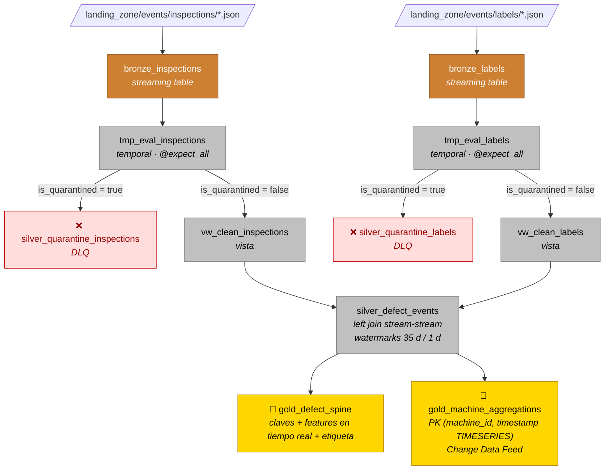

### 🥉 Bronze: ingesta cruda (`01_bronze_ingestion.py`)

- **Auto Loader** (`cloudFiles`) lee de forma continua los ficheros JSON que llegan al volumen `landing_zone`, con inferencia de tipos.
- Se usan *append flows* (`@dp.append_flow`), así que las tablas son **append-only** y nunca se sobrescriben.
- Se añaden columnas de **auditoría y linaje**: `ingestion_timestamp` y `source_file` (`_metadata.file_path`).

### 🥈 Silver: calidad, cuarentena y unión (`02_silver_transformation.py`)

**1. Calidad de datos declarativa.** Las reglas viven en un módulo independiente (`rules/`) y se recuperan por etiqueta con `get_rules("inspections")` / `get_rules("labels")`. Cada regla es un diccionario `{name, constraint, tag}` con la restricción en SQL, lo que permite auditarlas y mantenerlas sin tocar el pipeline.

| Dominio | Nº | Ejemplos de restricciones |
|---|:-:|---|
| Identidad y tiempo | 4 | `unit_id`, `timestamp`, `machine_id`, `material_batch_id` no nulos |
| Sensores y proceso | 12 | `temperature_celsius ∈ [220, 310]`, `pressure_bar ∈ [2, 8]`, `voltage_v ∈ [3.0, 3.6]`, `optical_density ∈ [0, 1]`, `tool_wear_pct ∈ [0, 100]`… |
| Contexto y categorías | 4 | `shift ∈ {morning, afternoon, night}`, `supplier_id ∈ {SUP_ALPHA…}`, `line_id ∈ {LINE_A…D}`, `machine_id LIKE 'MCH_%'` |
| Etiquetas | 3 | `unit_id` no nulo, `is_defective ∈ {0, 1}`, `label_available_date` no nulo |

**2. Patrón Dead Letter Queue.** `@dp.expect_all` registra las métricas de calidad en el *event log* del pipeline y, además, se calcula una bandera `is_quarantined = NOT (regla1 AND regla2 AND …)`. Con ella se separa el flujo en dos:
- Registros **válidos** → vista limpia → siguiente etapa.
- Registros **inválidos** → `silver_quarantine_*`, que se conservan para que el equipo de calidad los analice **sin detener el pipeline**.

**3. Join stream-stream con watermarks.** Las etiquetas llegan entre 1 y 30 días después de la inspección. Para gestionarlo se hace un **left outer join con estado**:

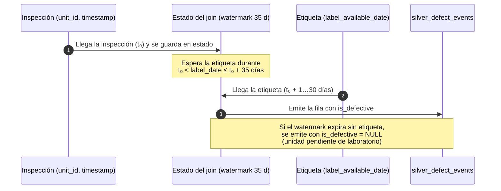

Condiciones del join: mismo `unit_id`, etiqueta **posterior** a la inspección y dentro de la ventana de 35 días (30 días del caso de uso + 5 de margen).

### 🥇 Gold: tablas para ML

**`gold_defect_spine` (el esqueleto de eventos).** Contiene las claves (`unit_id`, `machine_id`, `timestamp`), la etiqueta (`is_defective`, `label_available_date`) y las *features* disponibles en tiempo real desde la propia máquina: contexto (línea, turno, lote, experiencia del operario), lecturas físicas, estado de la máquina y SPC (`spc_xbar`, `spc_range`, `cumulative_defect_rate_shift`).

> 💡 **Detalle técnico:** tras un join con watermark, Spark conserva metadatos ocultos de *event time* en `label_available_date`. Se aplica una transformación irreversible (`timestamp → string → timestamp`) para eliminarlos y evitar conflictos aguas abajo.

**`gold_machine_aggregations` (tabla de features de comportamiento).** Agregaciones por máquina en tres resoluciones temporales:

| Ventana | Features |
|---|---|
| **1 h** (estado inmediato) | `count_units_1h`, `avg_vibration_1h`, `max_tool_wear_1h` |
| **8 h** (turno) | `count_units_8h`, `avg_vibration_8h`, `max_vibration_8h`, `avg_temperature_8h`, `stddev_cycle_time_8h` |
| **24 h** (día) | `count_units_24h`, `avg_vibration_24h` |
| **Derivada** | `vibration_1h_vs_8h_ratio`: ¿vibra la máquina ahora más que la media de su turno? Captura la **degradación de la máquina** (*concept drift*) |

- Las ventanas usan `rangeBetween(-N ms, -1)`, con lo que **cada inspección se excluye de su propia agregación** y no hay fuga de datos.
- Tiene una clave primaria `(machine_id, timestamp TIMESERIES)`, que habilita los *point-in-time lookups* del Feature Store.
- Tiene `delta.enableChangeDataFeed = true` para la publicación incremental al Online Store.

---

## 🧩 Feature Store

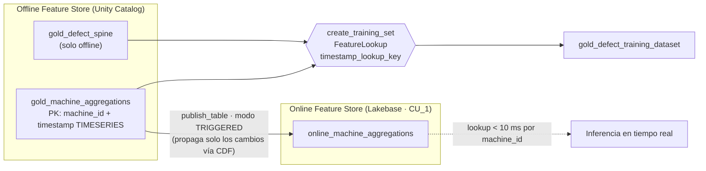

- **Offline:** el `FeatureLookup` sobre `gold_machine_aggregations` con `timestamp_lookup_key = "timestamp"` hace un **join AS OF**: a cada inspección se le asigna el valor más reciente de la feature cuyo *timestamp* sea **anterior o igual** al de la inspección.
- **Online** (`04_Feature_Store_Registration`): se publica únicamente la tabla de agregaciones, porque es la que aporta el estado dinámico de la máquina en inferencia. El modo `TRIGGERED` se eligió porque la capa Gold se recalcula por lotes: así se propagan solo los cambios acumulados, con un coste menor que un *streaming* continuo.
  > El código de creación y publicación está implementado pero **comentado**, porque Lakebase requiere un plan Premium.

---

## 🗃️ Dataset de entrenamiento y versionado de datos

`05_Training_Dataset_Generation` materializa el *point-in-time join* **una sola vez** y lo guarda como tabla Delta estática (`gold_defect_training_dataset`). Esto tiene varias ventajas: los experimentos no repiten el join (la operación más costosa), el dataset queda **congelado e inmutable** y sirve de referencia para la monitorización.

**Validaciones previas a la escritura:**
1. Nulos por feature (cobertura del Feature Store).
2. Mismo número de filas que la *spine*, para descartar duplicados o pérdidas en el join.
3. Balance de clases y detección de unidades **aún sin etiqueta**, que se filtran (`is_defective IS NOT NULL`).
4. Se excluye `label_available_date`, que no estaría disponible en inferencia.

**Metadatos de trazabilidad**, persistidos como `TBLPROPERTIES` (legibles por código) y como `TAGS` (visibles en Catalog Explorer):

| Propiedad | Propósito |
|---|---|
| `ml.delta_semantic_version` | Contador de negocio que se incrementa en cada regeneración (0 = inicial, 1 = primer ciclo de producción…) |
| `ml.delta_physical_version` | Versión física de Delta capturada **justo después del `WRITE`** y antes de los `ALTER TABLE`, para que el *time travel* apunte a los datos y no a una operación de metadatos |
| `ml.data_max_date` | Fecha máxima de los datos del ciclo actual |
| `ml.data_previous_max_date` | Fecha máxima del ciclo anterior. Ancla el *test window* del siguiente reentrenamiento |
| `ml.spine_table`, `ml.feature_table_1`, `ml.label_col`, `ml.num_rows`, `ml.num_features`, `ml.generated_at` | Linaje completo |

Valores reales en el workspace: `ml.num_rows = 24000024`, `ml.num_features = 32`, `ml.delta_semantic_version = 8` (el dataset se ha regenerado 8 veces), `ml.delta_physical_version = 25`, `ml.data_max_date = 2024-12-31`.

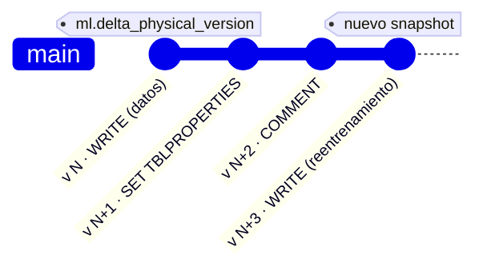

---

## 🧪 Entrenamiento y experimentación

### Patrón orquestador / workers aislados

Spark Connect guarda en caché los modelos MLlib con un **límite de 1 GB por sesión**, de modo que un *grid search* dentro de una única sesión acaba fallando con `ML_CACHE_SIZE_OVERFLOW_EXCEPTION`. La solución es separar responsabilidades:

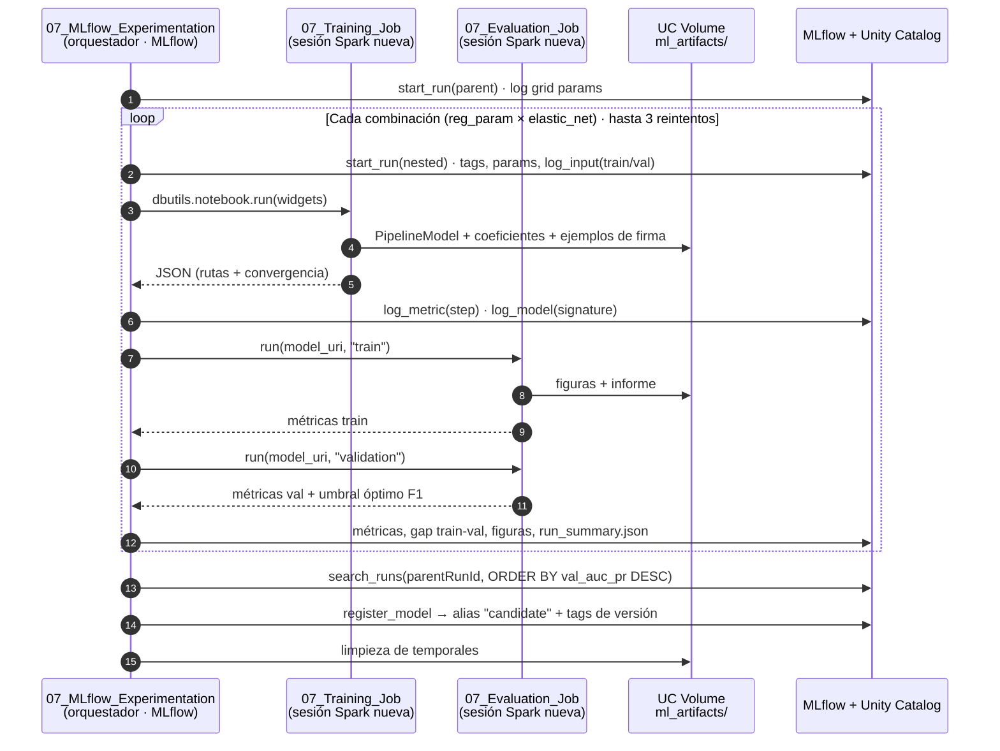

### Pipeline de Spark ML

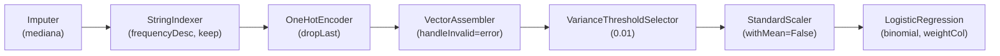

| Decisión | Motivo |
|---|---|
| Imputar solo `avg_*`, `max_*`, `stddev_*` y el ratio; no imputar `count_*` | Las ventanas vacías dan `count = 0` (valor correcto) pero `avg/max = NULL` |
| `VectorAssembler(handleInvalid="error")` | Actúa como guarda de calidad: falla si queda algún nulo sin imputar |
| `StandardScaler(withMean=False)` | Preserva la dispersión (*sparsity*) de los vectores *one-hot* |
| `standardization=False` en la regresión logística | Evita escalar dos veces |
| `handleInvalid="keep"` en los codificadores | Tolera categorías nuevas en producción |
| Pesos `n_total / (2 · n_clase)` recalculados en cada partición | Mantiene el balance aunque cambie la proporción de defectos |
| Exclusión de `unit_id`, `machine_id`, `material_batch_id` y `timestamp` del vector | Evita sobreajustar a identificadores, aunque se conservan para trazabilidad |

**Búsqueda de hiperparámetros:** `regParam ∈ {0.001, 0.01, 0.1}` × `elasticNetParam ∈ {0.0, 0.5}` × `maxIter = 100` (6 ejecuciones hijas, con semilla fija).

**Métrica de selección:** `val_auc_pr`. Con clases muy desbalanceadas, el AUC-ROC es demasiado optimista, mientras que el AUC-PR mide la capacidad real de detectar la clase minoritaria.

### Lo que se registra en MLflow

| Categoría | Contenido |
|---|---|
| Parámetros | Preprocesado (`pp_*`) y clasificador (`lr_*`), centralizados en el orquestador |
| Métricas | AUC-PR, AUC-ROC, F1, *precision*, *recall* y *accuracy* (train/val), `gap_auc_pr`, `gap_auc_roc`, umbral óptimo de F1 |
| Métricas por paso | `lr_objective_history` (curva de convergencia de L-BFGS), `lr_converged` |
| Linaje | `mlflow.data.from_spark` + `log_input`, enlazados a la tabla Delta con su *digest* |
| Modelo | `mlflow.spark.log_model` con firma inferida a partir de ejemplos parquet |
| Artefactos | Curvas PR y ROC, matriz de confusión, calibración, barrido de umbral, coeficientes (`.png` y `.csv`), `classification_report`, `run_summary.json`, `grid_search_summary.json` |
| Tags | Proyecto, equipo, algoritmo, entorno, fechas de los *splits*, versiones de Spark y MLflow, estrategia de desbalance |

---

## 🏷️ Ciclo de vida del modelo en Unity Catalog

El modelo `workspace.<schema>.defect_lr_pipeline` se gobierna con **alias**, no con *stages* rígidos:

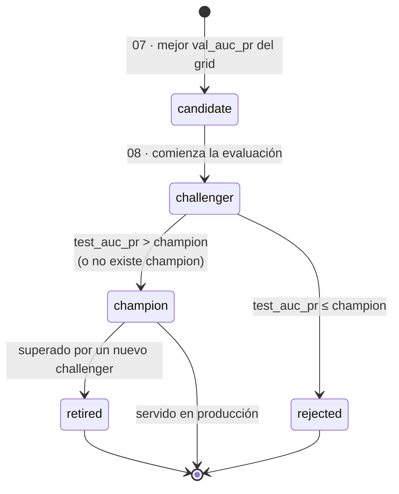

- **Tags de modelo** (persistentes): proyecto, equipo, algoritmo, *framework*.
- **Tags de versión** (específicos): `candidate_run_id`, `parent_run_id`, `production_run_id`, hiperparámetros completos, `val_auc_pr`, `test_auc_pr`, `best_threshold_val`, `train_end_date`, `test_end_date`, `promoted_by`, `retirement_reason` y `rejection_reason`.
- Cada versión `champion` lleva una **descripción autoexplicativa** con métricas e hiperparámetros, así que no hace falta abrir MLflow para entenderla.
- Las transiciones de alias se hacen en orden seguro (primero se asigna el nuevo y después se elimina el anterior) para que ninguna versión se quede sin estado.

**Estado real del registro** (`workspace.mario_panos2.defect_lr_pipeline`):

| Versión | Origen | Alias | Métricas clave |
|:-:|---|:-:|---|
| v1 | Grid search (`lr__rp0.001__en0.5`) | — (antiguo `candidate` → `challenger`) | Validación: AUC-PR 0,9843 |
| **v2** | Refit completo (`production_evaluation`) | **`@champion`** | Test: AUC-PR 0,9838 · AUC-ROC 0,9983 · F1 0,9986 |
| v3 | Nuevo grid search (reentrenamiento) | `@rejected` | Empate con el champion en test |

Cada versión tiene sus tags de linaje (`candidate_run_id`, `production_run_id`, `promoted_to_champion_by = auto__max_test_auc_pr`, hiperparámetros…) y una firma de MLflow con las claves, 21 features en tiempo real, 11 agregadas y las salidas `prob_defective` y `prediction`.

---

## 🥊 Evaluación en producción: champion vs challenger

`08_Production` es el **nodo final** del pipeline de reentrenamiento:

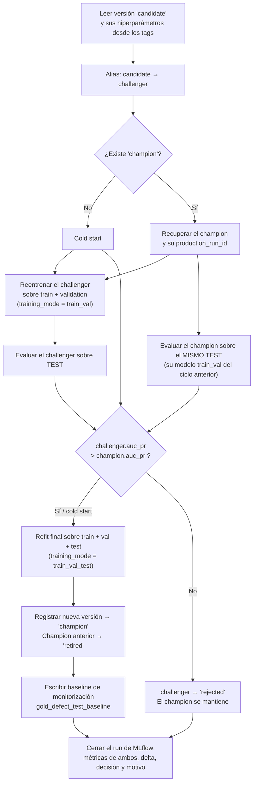

Garantías metodológicas:

- **El conjunto de prueba se usa una sola vez.** Nunca participa en la selección de hiperparámetros.
- **Comparación simétrica.** Ambos modelos se evalúan con el modelo reentrenado sobre train + val y sobre exactamente el mismo test.
- **Mejora estricta.** En caso de empate gana el `champion`: un modelo nuevo tiene que demostrar que es mejor.
- **Refit final.** El modelo que se despliega ha visto los datos más recientes, incluido el test.
- **Fallos trazables.** Cada etapa marca un tag `failure_stage` (`challenger_training`, `challenger_evaluation`, `champion_evaluation`, `full_refit`, `alias_update`, `baseline_write`) y cierra el run como `FAILED`.

---

## 📊 Monitorización

La monitorización está planteada **en capas**, desde el dato de entrada hasta el modelo en producción:

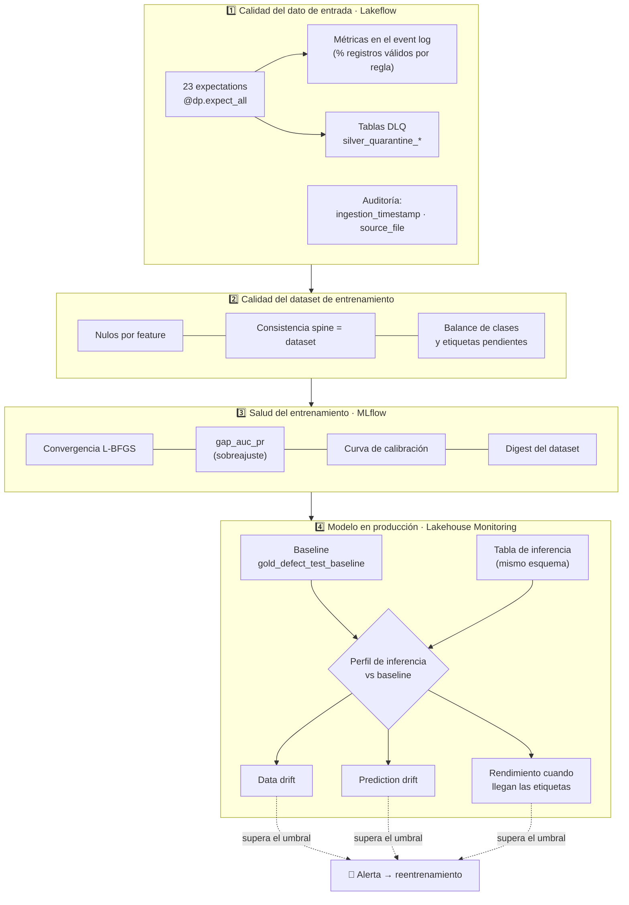

### 1. Calidad del dato (implementado)

- Cada regla aparece como **métrica en el event log** del pipeline (registros que la cumplen y que no), y se puede consultar en la interfaz de Lakeflow o mediante SQL.
- Las **tablas de cuarentena** guardan los registros inválidos íntegros, así que puede analizarse la causa raíz por sensor, máquina o proveedor sin detener la ingesta.
- Las columnas `source_file` e `ingestion_timestamp` permiten rastrear cualquier registro hasta el fichero de origen.

### 2. Calidad del dataset (implementado)

Validaciones automáticas antes de cada escritura de `gold_defect_training_dataset` (nulos, volumen y balance), con los metadatos registrados en Unity Catalog.

### 3. Salud del entrenamiento (implementado)

- `gap_auc_pr` y `gap_auc_roc` entre train y validación como indicador directo de sobreajuste. Incluye búsquedas de referencia del tipo `metrics.gap_auc_pr > 0.05`.
- Una curva de convergencia por paso para detectar modelos que no convergen (`lr_converged`).
- Curvas de calibración y barrido de umbral para comprobar que las probabilidades son fiables.
- El *digest* del dataset en MLflow cambia si los datos cambian entre experimentos.

### 4. Modelo en producción (baseline implementado, monitor diseñado)

Cuando se promueve un nuevo `champion`, `08_Production` escribe **`gold_defect_test_baseline`**: el conjunto de prueba con las predicciones del champion (`prediction`, `prob_defective`, `model_version`, `inference_timestamp`). Se descartan las columnas internas de Spark ML (`features`, `rawPrediction`, `probability`). La tabla incluye en sus propiedades `ml.champion_version`, `ml.test_auc_pr`, `ml.test_f1`, `ml.best_threshold_val`, `ml.production_run_id` y la versión física de Delta.

En el workspace, el baseline actual tiene **5.967.750 filas** con las predicciones del champion v2, generadas por la ejecución `a82fc201…` (`ml.test_auc_pr = 0.9838`, `ml.test_f1 = 0.9986`, `ml.best_threshold_val = 0.93`).

**¿Por qué el test es el baseline?** Es el único conjunto con métricas imparciales (las mismas que justificaron la promoción) y el más reciente en el tiempo, así que es la mejor aproximación a la distribución que verá el modelo en producción.

Sobre ese baseline, el monitor de **Databricks Lakehouse Monitoring** (perfil de inferencia) compararía la tabla de inferencia con el baseline para detectar:

| Señal | Qué detecta |
|---|---|
| **Data drift** de las features | Cambios en sensores, proveedores, turnos o degradación de máquinas (por ejemplo, `vibration_1h_vs_8h_ratio`) |
| **Prediction drift** | Cambios en la distribución de `prob_defective` y en la tasa de defectos predicha |
| **Rendimiento real** | AUC-PR y F1 cuando llegan las etiquetas retrasadas, unidas por `unit_id` |
| **Por versión** | Segmentación por `model_version` para comparar modelos |

Si alguna señal supera el umbral configurado, se genera una **alerta** que dispara el ciclo de reentrenamiento.

> **Estado actual:** el monitor todavía no está creado. En Unity Catalog, la opción *Data Quality Monitoring* del baseline aparece como desactivada, y el job de reentrenamiento no tiene triggers ni notificaciones, así que hoy se lanza a mano.

---

## 🔁 Reentrenamiento

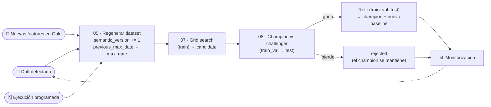

### Modos de entrenamiento

El mismo `07_Training_Job` sirve para todas las fases mediante el widget `training_mode`:

| Modo | Datos | Cuándo se usa |
|---|---|---|
| `train` | Entrenamiento | Búsqueda de hiperparámetros (07) |
| `train_val` | Entrenamiento + validación | Evaluación justa del challenger frente al champion (08) |
| `train_val_test` | Histórico completo | Refit final del modelo que se despliega (08) |

### Ventanas temporales

Los *splits* son **estrictamente temporales** (nunca aleatorios) para simular producción. La configuración inicial (versión 0 del dataset) es:

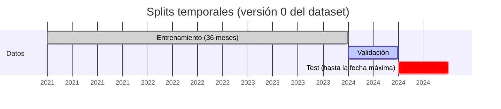

En los ciclos posteriores, el diseño encadena las ventanas con los metadatos del dataset:
- **Test** = desde `ml.data_previous_max_date` hasta `ml.data_max_date` (los datos nuevos del ciclo).
- **Validación** = los `VALIDATION_WINDOW_MONTHS` (12) anteriores al test.
- **Entrenamiento** = los `TRAINING_WINDOW_MONTHS` (36) anteriores a la validación. El límite evita que patrones antiguos degraden el modelo.

### Reproducibilidad de cada ciclo

Cada modelo puede reconstruirse exactamente a partir de:
`ml.delta_physical_version` (*time travel* al snapshot) + hiperparámetros (tags de versión en UC) + semilla fija (`45127`) + `candidate_run_id` y `production_run_id` (MLflow).

---

## 🚀 Despliegue y ejecución

El proyecto es un **Databricks Asset Bundle** con dos *targets*:

| Target | Modo | Esquema | Comportamiento |
|---|---|---|---|
| `dev` (por defecto) | `development` | `${workspace.current_user.short_name}` | Recursos con el prefijo `[dev usuario]` y *schedules* en pausa |
| `prod` | `production` | `prod` | Ruta única en el workspace y permisos `CAN_MANAGE` explícitos |

Recursos definidos en el bundle:
- **Pipeline** `control_de_calidad_en_manufactura_etl`: *serverless*, catálogo y esquema parametrizados, e incluye todas las transformaciones de `transformations/**`.
- **Job** de refresco del pipeline con trigger periódico **diario** (`sample_job`).

### Lo que hay desplegado en el workspace

El bundle se desplegó con el target `dev`, por eso el pipeline se llama `[dev mario_panos2] control_de_calidad_en_manufactura_etl`. Además, se crearon desde la interfaz **dos jobs** que orquestan el ciclo completo:

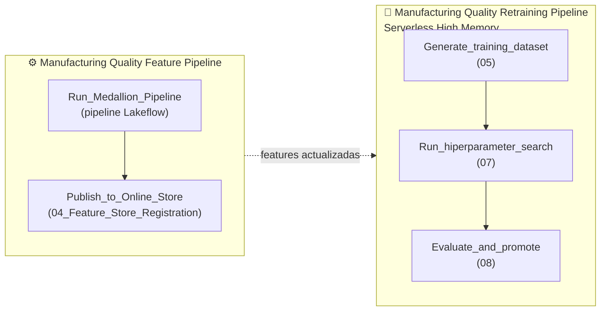

| Recurso en el workspace | Detalle |
|---|---|
| Esquema `workspace.mario_panos2` | 9 tablas, el volumen `ml_artifacts`, el modelo `defect_lr_pipeline` |
| Esquema `workspace.calidad_manufactura` | Volumen `landing_zone` con los ficheros JSON de entrada |
| Experimento MLflow | `/Users/mario.panos2@alu.uclm.es/.experiments/mario_panos2/defect_detection_training`, con **56 ejecuciones** (búsquedas de hiperparámetros, ejecuciones hijas y evaluaciones de producción) |
| Tipos de tabla | Bronze, Silver y `gold_defect_spine` como *streaming tables*; `gold_machine_aggregations` como *materialized view* con CDF |

```bash
# 1. Autenticación
databricks configure

# 2. Validar y desplegar en desarrollo
databricks bundle validate
databricks bundle deploy --target dev

# 3. Ejecutar el pipeline ETL (Bronze → Silver → Gold)
databricks bundle run control_de_calidad_en_manufactura_etl

# 4. Desplegar en producción
databricks bundle deploy --target prod
```

**Orden de ejecución del ciclo ML** (notebooks):

```text
ETL pipeline → 04_Feature_Store_Registration → 05_Training_Dataset_Generation
            → 07_MLflow_Experimentation (lanza 07_Training_Job / 07_Evaluation_Job)
            → 08_Production
```

**Requisitos previos:** un workspace de Databricks con Unity Catalog, un volumen `landing_zone` con las rutas `events/inspections` y `events/labels`, un volumen `ml_artifacts` (que usa `MLFLOW_DFS_TMP` para serializar modelos en *serverless*) y Python 3.10–3.12 para el desarrollo local con `databricks-connect`.

---

## 🧠 Decisiones de diseño

| Problema | Solución adoptada | Alternativa descartada |
|---|---|---|
| Registros inválidos en la ingesta | Expectations + DLQ: se observan y se aíslan | `expect_or_fail` (detiene el pipeline) o `expect_or_drop` (pierde los datos para auditoría) |
| Etiquetas retrasadas | Left join stream-stream con watermark de 35 días | Join batch diario (más latencia y reprocesamiento) |
| Fuga de datos en las agregaciones | `rangeBetween(-N, -1)` + PiT join | Ventanas que incluyen el evento actual |
| Coste del PiT join | Se materializa una vez en Delta y se versiona | Recalcularlo en cada experimento |
| Caché de 1 GB de Spark Connect | Workers aislados con `dbutils.notebook.run` | *Grid search* en una sola sesión |
| Desbalance de clases | Pesos por frecuencia inversa + AUC-PR + umbral optimizado para F1 | *Accuracy* o AUC-ROC como criterio |
| Promoción insegura | Alias, test de un solo uso y mejora estricta | Sobrescribir el modelo en producción |
| Coste del Online Store | Una única instancia `CU_1` para varias tablas y publicación `TRIGGERED` | Publicación continua |
| Reglas de calidad dispersas | Módulo `rules/` centralizado y etiquetado | Restricciones *hard-coded* en cada tabla |

---

## 🗺️ Estado del proyecto y hoja de ruta

| Componente | Estado |
|---|:-:|
| Pipeline Bronze / Silver / Gold con reglas de calidad y DLQ | ✅ |
| Tablas de features con PK `TIMESERIES` y CDF | ✅ |
| Dataset de entrenamiento con PiT join y versionado doble | ✅ |
| Experimentación con MLflow y registro de `candidate` | ✅ |
| Champion vs challenger, refit y gestión de alias | ✅ Ejecutado: v2 `champion`, v3 `rejected` |
| Baseline de monitorización (`gold_defect_test_baseline`) | ✅ 5,97 M filas |
| Jobs de features y de reentrenamiento `05 → 07 → 08` | ✅ Creados en el workspace y ejecutados |
| Asset Bundle `dev` / `prod` | ✅ Desplegado en `dev` |
| Online Feature Store (Lakebase) | 🟡 Implementado y comentado (requiere plan Premium) |
| Monitor de Lakehouse Monitoring sobre la tabla de inferencia + alertas | 🟡 Diseñado, con el baseline ya preparado; monitor sin crear |
| Ventanas de *split* dinámicas a partir de `ml.data_previous_max_date` | 🟡 Metadatos persistidos; los *splits* de la versión 0 usan fechas fijas |
| Triggers y notificaciones del job de reentrenamiento | 🔲 Pendiente (hoy se lanza a mano) |
| Jobs de ML definidos como código en el bundle | 🔲 Pendiente (creados desde la interfaz) |
| Endpoint de Model Serving con `fe.log_model` (lookup automático de features) | 🔲 Pendiente |
| Tests unitarios (`pytest`) de las reglas y transformaciones | 🔲 Pendiente |

---

## 👥 Equipo

Proyecto desarrollado por el **Grupo 7** en un entorno académico (UCLM).

> 📚 **Reconocimiento:** este trabajo está basado en los materiales proporcionados por el profesor de la asignatura (Juan Carlos Alfaro Jiménez), en particular en las plantillas de los notebooks de MLOps (generación del dataset, experimentación con MLflow, jobs de entrenamiento y evaluación, y promoción a producción). El equipo adaptó esos materiales al caso de uso de control de calidad en manufactura: reglas de calidad de datos, capas Silver y Gold, features por máquina, Feature Store y la configuración del ciclo de entrenamiento y promoción.

| Integrante | GitHub |
|---|---|
| Mario Paños Giraldo | [@MarioPG21](https://github.com/MarioPG21) |
| Carlos | [@holt00](https://github.com/holt00) |
